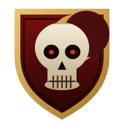

  

<h1 align="center">Vampire Survivors Trainer</h1>

<!-- latest-download -->

  <b>Latest · Última versión: v1.0.2</b> — VampireSurvivors.exe v1.16.111 (Steam) 
  <a href="https://github.com/matcarfer/vampire-survivors-trainer/releases/download/v1.0.2/VampireSurvivors-v1.16.111-Trainer-v1.0.2.exe"><b>⬇ Download · Descargar VampireSurvivors-v1.16.111-Trainer-v1.0.2.exe</b></a> 
  SHA-256 <code>2AD018DE14965C9EE141511994CCC4270B1E37803099E4F7789FFC8114E8A97D</code>

<!-- /latest-download -->

**EN** — Offline, single-player trainer for **Vampire Survivors** v1.16.111
(Steam build 25984009, Windows x64). One-screen 16:9 interface with 12 cards,
F1–F12 hotkeys, synthesized toggles, EN/ES, and an always-visible panel showing
the detected EXE, its path, version and Steam build.

**ES** — Trainer offline para **Vampire Survivors** v1.16.111 (build de Steam
25984009, Windows x64). Interfaz 16:9 de una sola pantalla con 12 tarjetas,
teclas F1–F12, sonidos al activar, EN/ES y un panel siempre visible con el EXE
detectado, su ruta, la versión y el build de Steam.

> **Offline only / Solo offline:** personal use in single-player on your own PC.
> Never online, in multiplayer, or to bypass anti-cheat.
> Uso personal en modo individual y en tu propia PC. Nunca online, en
> multijugador ni para evadir sistemas anti-cheat.

---

## How to use / Cómo usarlo

1. Download the `.exe` from the link above / Descargá el `.exe` del link de arriba.
2. Start the trainer, then start the game (or the other way around).
   Abrí el trainer y después el juego (o al revés).
3. The header shows **CORRECT EXE** when the process and Steam build match.
   La cabecera muestra **EXE CORRECTO** cuando el proceso y el build coinciden.
4. All cards start **OFF**. Click one or press its F-key while the game is focused to turn it on.
   Todas las tarjetas arrancan **APAGADAS**. Hacé clic en una o presioná su tecla F con el juego enfocado para activarla.
5. Closing the trainer restores the game's original code.
   Al cerrar el trainer se restaura el código original del juego.

| Key / Tecla | EN | ES |
|---|---|---|
| F1 | God Mode | Modo Dios |
| F2 | Max HP | Vida Máxima |
| F3 | Move Speed | Velocidad |
| F4 | Power | Poder |
| F5 | Luck | Suerte |
| F6 | Cooldown | Cadencia |
| F7 | Gold Multiplier | Multiplicador de Oro |
| F8 | XP Multiplier | Multiplicador de XP |
| F9 | Growth | Crecimiento |
| F10 | Coins Editor | Editor de Monedas |
| F11 | Current XP | XP Actual |
| F12 | Area | Área |

The executable also supports `--verify`, `--diag`, `--cli`, `--probe`,
`--restore`, `--lang en|es` and `--help`. `--probe` shows pointers and stat
values before/after applying; `--restore` removes a hook left by a trainer that
was killed before restoring the game code.
El ejecutable también admite `--verify`, `--diag`, `--cli`, `--probe`,
`--restore`, `--lang en|es` y `--help`. `--probe` muestra punteros y valores
antes/después de aplicar; `--restore` quita un hook huérfano de un trainer que
fue matado antes de restaurar el código del juego.

---

## Verify the download / Verificá la descarga

- SHA-256: `2AD018DE14965C9EE141511994CCC4270B1E37803099E4F7789FFC8114E8A97D`
- PowerShell: `Get-FileHash .\VampireSurvivors-v1.16.111-Trainer-v1.0.2.exe -Algorithm SHA256`

Some antivirus engines flag every game trainer because it writes to another
program's memory. The file is not code-signed: if Windows SmartScreen appears,
choose **More info → Run anyway**.
Algunos antivirus marcan todos los trainers porque escriben en la memoria de otro
programa. El archivo no está firmado: si aparece "Windows protegió tu PC", elegí
**Más información → Ejecutar de todas formas**.

---

## Legal / Aviso legal

Unofficial, fan-made tool. Not affiliated with the game's developers or publisher.
Provided "as is", without warranty; use at your own risk and back up your saves.
Free to download and use; redistribution is not allowed — share this page instead.
See [LICENSE](LICENSE).

Herramienta no oficial hecha por un fan. Sin relación con los desarrolladores ni
la editorial. Se entrega "tal cual", sin garantía; usala bajo tu responsabilidad
y hacé copia de tus partidas. Es gratis; no está permitido redistribuirla:
compartí el link a esta página. Ver [LICENSE](LICENSE).
